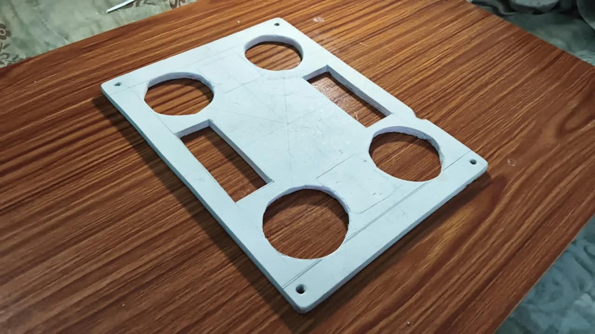
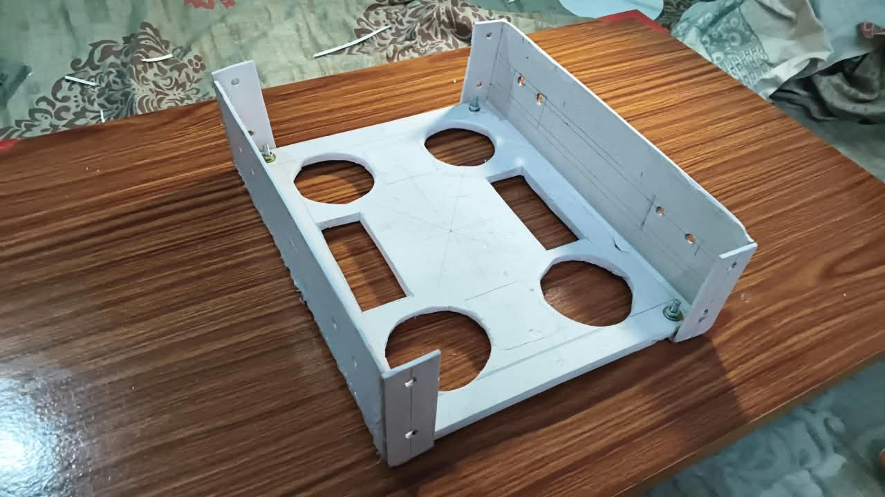
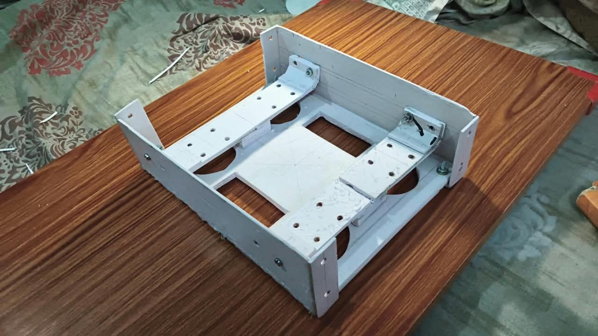
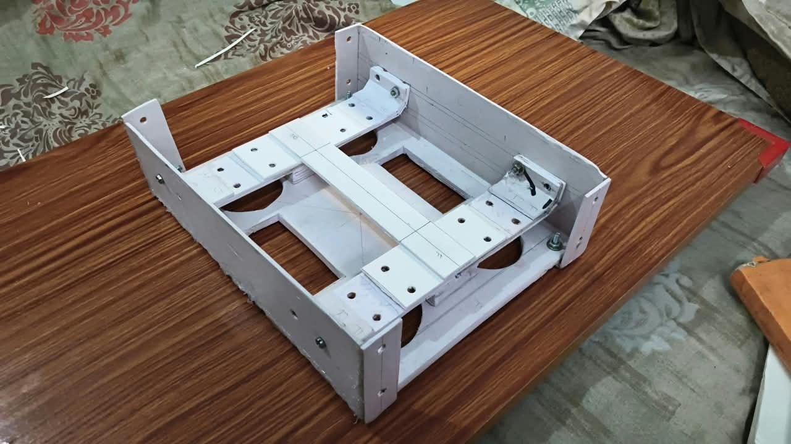
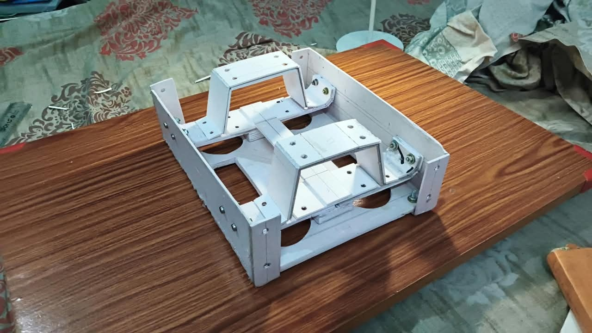
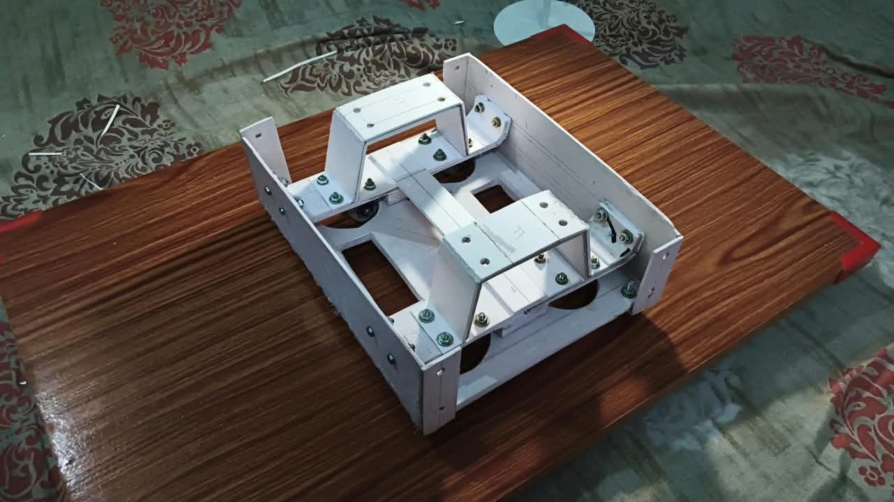
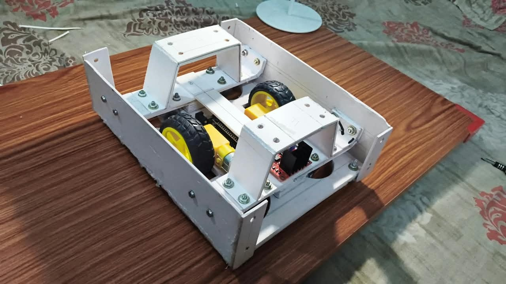
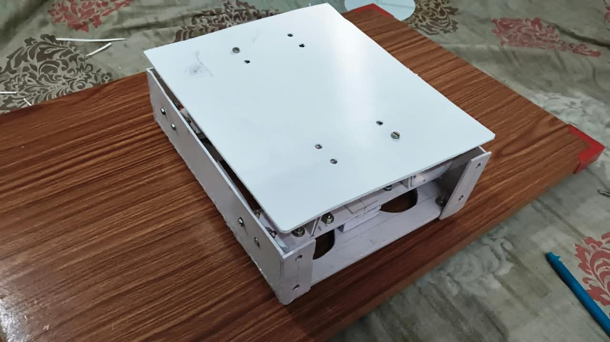
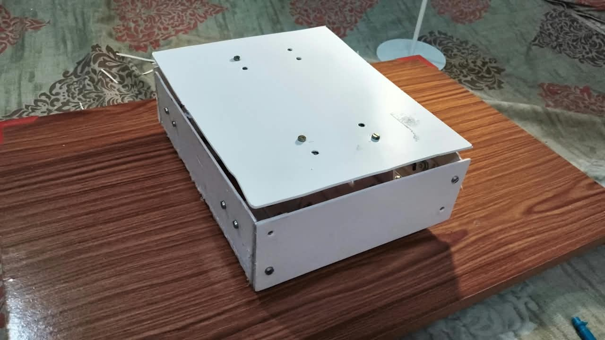

# 🚀 Orbit V1: Modular Autonomous Mobile Robot (AMR)

<div align="center">

[](https://sih.gov.in/)
[](https://sih.gov.in/)
[](#)
[](#)

**Modular AGV/AMR platform for warehouse automation featuring quick-swap attachments and a 10ft 9-layer telescopic robotic arm.**

</div>

---

## 🛠️ Physical Prototype

> **Fabrication Note:** To build the physical prototype chassis, **Sun Board** was crafted by our team. For digital design, these same components are being optimized using **Generative Design**, **Topology Optimization**, and **Simulation** features in **Autodesk Fusion**.

### 🧩 Components

<table>
  <tr>
    <td align="center" width="33%">
      <br/>
      <b>Base Plate</b>
    </td>
    <td align="center" width="33%">
      <br/>
      <b>Side Walls</b>
    </td>
    <td align="center" width="33%">
      <br/>
      <b>Caster Wheel Support</b>
    </td>
  </tr>
  <tr>
    <td align="center" width="33%">
      <br/>
      <b>Center Support</b>
    </td>
    <td align="center" width="33%">
      <br/>
      <b>Roof Support</b>
    </td>
    <td align="center" width="33%">
      <br/>
      <b>Roof Plate</b>
    </td>
  </tr>
  <tr>
    <td align="center" width="33%">
      <br/>
      <b>Front & Back Walls</b>
    </td>
    <td align="center" width="33%"></td>
    <td align="center" width="33%"></td>
  </tr>
</table>

---

### 🔧 Assembly

<table>
  <tr>
    <td align="center" width="33%">
      <br/>
      <b>Step 1</b>
    </td>
    <td align="center" width="33%">
      <br/>
      <b>Step 2</b>
    </td>
    <td align="center" width="33%">
      <br/>
      <b>Step 3</b>
    </td>
  </tr>
  <tr>
    <td align="center" width="33%">
      <br/>
      <b>Step 4</b>
    </td>
    <td align="center" width="33%">
      <br/>
      <b>Step 5</b>
    </td>
    <td align="center" width="33%">
      <br/>
      <b>Step 6</b>
    </td>
  </tr>
  <tr>
    <td align="center" width="33%">
      <br/>
      <b>Step 7</b>
    </td>
    <td align="center" width="33%">
      <br/>
      <b>Step 8</b>
    </td>
    <td align="center" width="33%">
      <br/>
      <b>Step 9</b>
    </td>
  </tr>
</table>

---

### 🏎️ Assembled Chassis & Ground Clearance

<table>
  <tr>
    <td align="center" width="50%">
      <br/>
      <b>Bottom View After Assembly</b>
    </td>
    <td align="center" width="50%">
      <br/>
      <b>Ground Clearance</b>
    </td>
  </tr>
</table>

---

## ⚙️ Prototype Subsystems

| Subsystem | Hardware | Firmware / Code | Function |
| :--- | :--- | :--- | :--- |
| **Mobile Base** | ESP32, L298N Driver, Dual DC Motors, 4 Casters | [`car-master.ino`](file:///home/aditya/Documents/Projects/sih-2026/prototype/hardware/robot-test/car-master/car-master.ino) | Bidirectional motion, PWM speed control, auto-stop safety timeout |
| **Telescopic Arm** | ESP32, PCA9685 I2C Driver, 4 Servos | [`arm-test.ino`](file:///home/aditya/Documents/Projects/sih-2026/prototype/hardware/arm-test/arm-test.ino) | 4-DOF arm joint control + dual-pulley 10ft mast ("Pull to expand, Pull to collapse") |
| **275° Sonar Radar** | 28BYJ-48 Stepper, ULN2003, HC-SR04 | [`lidar-test.ino`](file:///home/aditya/Documents/Projects/sih-2026/prototype/hardware/lidar-test/lidar-test.ino) | 275° sweep with 1° precision for obstacle detection and mapping |
| **Camera Stream** | AI-Thinker ESP32-CAM (OV2640) | [`camera-test.ino`](file:///home/aditya/Documents/Projects/sih-2026/prototype/hardware/camera-test/camera-test.ino) | Real-time wireless video stream uploaded to server |
| **Control Server** | FastAPI, WebSockets, Uvicorn | [`prototype/server/`](file:///home/aditya/Documents/Projects/sih-2026/prototype/server) | Web dashboard for robot drive, arm sliders, and video view |

---

## 🎯 Problem & Solution

- **Problem:** Building dedicated single-purpose robots for every warehouse task is expensive and inefficient. Traditional tall robots risk tipping over in narrow aisles, while small robots cannot reach 10ft high racks.
- **Solution:** A modular AGV platform (800mm × 600mm × 300mm) with a universal dock:
  - **4-Pin D20 Connector:** Provides 24V power, GND, CAN-High, and CAN-Low.
  - **10ft Telescopic Arm:** Travels collapsed to prevent tipping; expands only at the rack to reach high shelves.
  - **Swap in < 5 mins:** Switch between Robotic Arm, Bin Handling, Scanner, and Mapping attachments on the same base.

```
       ┌────────────────────────────────────────────────────────┐
       │                  Modular Attachments                   │
       │   [ 10ft Robotic Arm ]   [ Bin Handler ]   [ Mapper ]  │
       └───────────────────────────┬────────────────────────────┘
                                   │ Universal 4-Pin D20 CAN
                                   ▼
       ┌────────────────────────────────────────────────────────┐
       │               Orbit V1 AGV Mobile Base                 │
       │       (800mm x 600mm x 300mm | Differential Drive)     │
       └────────────────────────────────────────────────────────┘
```

---

## 💰 Bill of Materials (BOM)

| Module | Cost (INR) | Key Components |
| :--- | :--- | :--- |
| **AGV Mobile Base** | ₹1,14,550 | BLDC Hub Motors, Motor Driver, LiFePO4 Battery + BMS, Caster Wheels, Compute (Pi/STM32), QR Camera, Safety Sensors |
| **Telescopic Arm Attachment** | ₹1,35,700 | 9-Layer CNC Aluminum Mast, Stepper & Pulley Assembly, Joint Servos, Gripper, Hand Camera |
| **Assembly & Testing** | ₹33,000 | 3D Printing post-processing, wiring harness, calibration |
| **Total System Cost** | **₹2,83,250** | *Market AGVs in India start at ₹1.8L+ for non-modular bases alone.* |

---

## 🚀 Quick Start

### 1. Run Control Server
```bash
cd prototype/server
python3 -m venv venv
source venv/bin/activate
pip install -r requirements.txt
uvicorn app.main:app --host 0.0.0.0 --port 8000 --reload
```
- API Docs: `http://localhost:8000/docs`
- Live Stream: `http://localhost:8000/live`

### 2. Flash Hardware (Arduino IDE)
1. Install **ESP32 by Espressif** and **ArduinoJson** library.
2. Open sketch from `prototype/hardware/` (e.g., `robot-test/car-master/car-master.ino`).
3. Set your Wi-Fi credentials (`ssid`, `password`) and server IP.
4. Select `ESP32 Dev Module` and click **Upload**.

---

<div align="center">
  <b>Smart India Hackathon 2026 • Team Orbit V1 (ID: 158993)</b>
</div>
